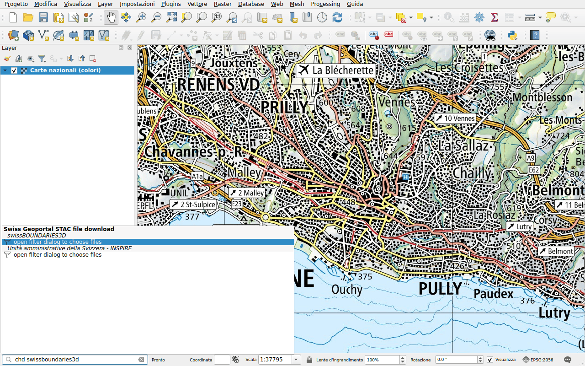
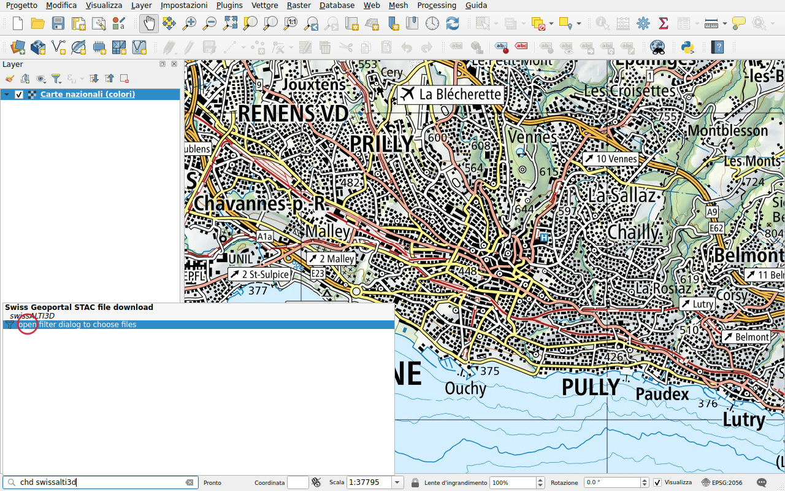
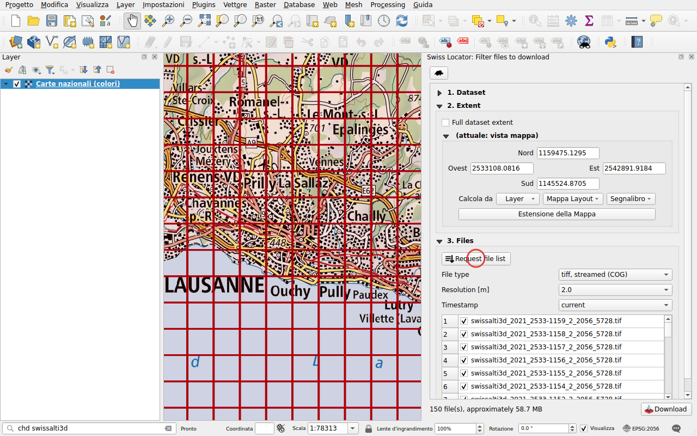

# Scaricare dati (STAC)

Prefisso: `chd`

Scaricare file e aggiungerli alla mappa, da tre cataloghi di dati:

- quello del geoportale federale, [data.geo.admin.ch](https://data.geo.admin.ch):
  modelli altimetrici, immagini aeree, confini, carte e altro ancora;
- [viageo.ch](https://viageo.ch), i geodati di
  [cantoni e comuni](viageo.md);
- [geo.bs.ch](https://www.geo.bs.ch), i geodati del Cantone di
  [Basilea Città](basel-stadt.md).

La ricerca considera i nomi dei set di dati. Ogni catalogo elenca i suoi
risultati sotto il proprio nome, ed è una ricerca a sé nelle
[opzioni di QGIS](../configuration.md#in-the-options-of-qgis): deselezionarne uno
per escluderlo, o dargli un prefisso proprio.

## Un set di dati con pochi file

Digitare `chd swissboundaries3d`. Quando un set di dati ha pochi file, questi
vengono elencati direttamente, con il loro formato.

Fare doppio clic su un file e scegliere una cartella: il file viene scaricato,
poi aggiunto alla mappa. Gli archivi (ZIP) del geoportale vengono solo
scaricati, salvo se contengono una nuvola di punti, come swissSURFACE3D fino al
2023: la nuvola di punti viene estratta accanto all'archivio e aggiunta alla
mappa. QGIS la indicizza prima di visualizzarla, il che richiede un momento.

I file che QGIS può leggere via rete, come i Cloud Optimized GeoTIFF e i Cloud
Optimized Point Cloud (COPC), sono elencati due volte: la seconda voce,
contrassegnata con *streamed*, aggiunge il file alla mappa senza scaricarlo.

## Un set di dati con molti file

Digitare `chd swissalti3d`. Il modello altimetrico è suddiviso in riquadri di un
chilometro quadrato, troppi per essere elencati: il risultato apre un pannello
di filtro.

Nel pannello **Swiss Locator: Filter files to download**:

1. **Extent**: per impostazione predefinita, i file che coprono la vista della
   mappa. Può essere anche l'estensione completa del set di dati, l'estensione
   di un layer, di una mappa di un layout di stampa o di un segnalibro.
2. Fare clic su **Request file list**, poi scegliere il tipo di file
   (**File type**), la risoluzione (**Resolution [m]**) e la data
   (**Timestamp**). I contorni dei file vengono disegnati sulla mappa.
3. Fare clic su **Download**.

Il numero di file elencati direttamente nella barra di localizzazione può essere
impostato nella [configurazione](../configuration.md).
