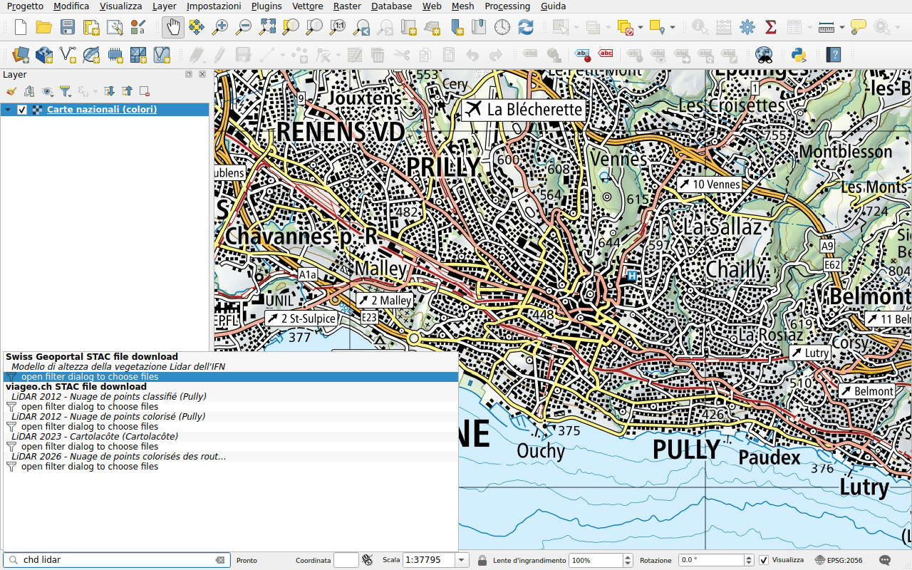

# Dati cantonali e comunali (viageo.ch)

Prefisso: `chd`

[viageo.ch](https://viageo.ch) pubblica i dati del Canton Vaud e dei suoi
comuni: la batimetria dei laghi, immagini aeree di 2 cm e nuvole di punti
LiDAR. I suoi titoli sono in francese: digitare `lidar`, `orthophoto` o
`bathymétrie`, con gli accenti.

I suoi risultati funzionano [come quelli del geoportale](swisstopo.md): un'immagine
aerea o una batimetria è un unico file, da scaricare o da aggiungere come
*streamed*; una nuvola di punti apre il pannello di filtro. Alcuni file sono
grandi, come l'immagine aerea di Pully di giugno 2026, 35 GB: aggiungerla come
*streamed*.
