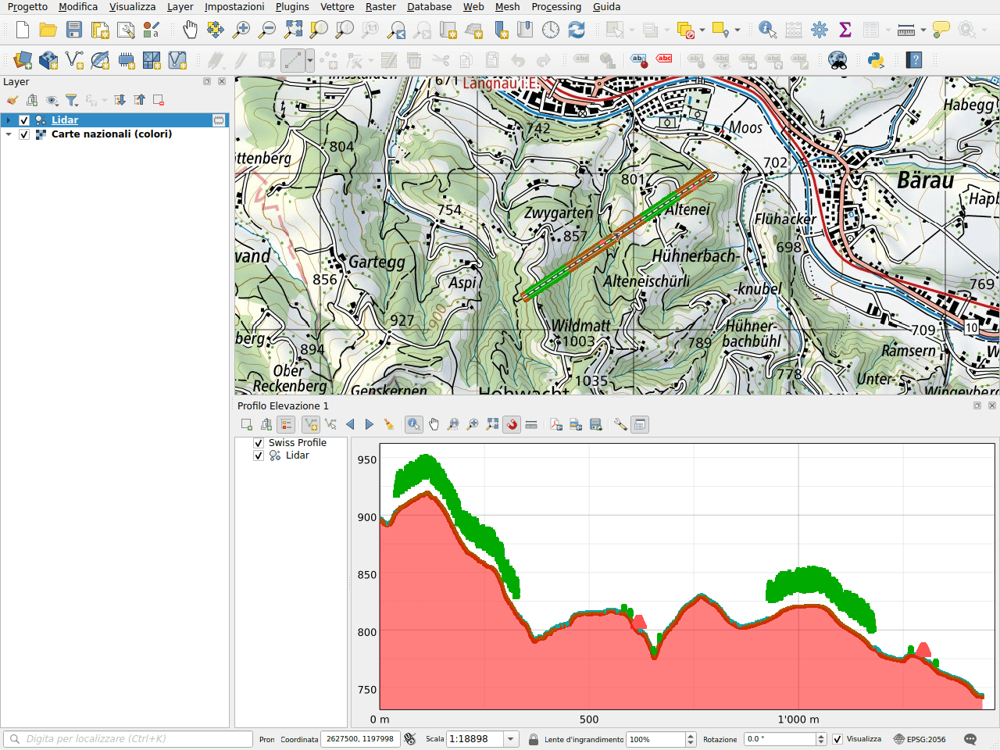

# Profilo altimetrico

Il plugin aggiunge il terreno di swisstopo ai profili altimetrici di QGIS. Le
quote provengono dal servizio di profilo del geoportale, che usa il modello
altimetrico swissALTI3D. Non è necessario caricare alcun layer: il profilo è
calcolato online per la linea disegnata.

## Disegnare un profilo

1. Aprire **Visualizza ▸ Profili Elevazione ▸ Nuovo Profilo Elevazione**.
2. Fare clic su **Cattura Curva** nella barra degli strumenti del profilo, poi
   disegnare la linea sulla mappa: un clic per ogni vertice, un clic destro per
   terminare.
3. Il terreno di swisstopo è disegnato come **Swiss Profile**, in rosso.

## Esempio: con una nuvola di punti lidar

Il profilo mostra i layer del progetto insieme al terreno. Qui, una nuvola di
punti lungo una linea di 1,4 km sulle colline di Langnau im Emmental: il suolo,
gli alberi e i tetti di due fattorie poggiano sul terreno di swissALTI3D.

!!! note
    La nuvola di punti di questo esempio è stata creata per la documentazione.
    Quelle reali, come swissSURFACE3D, possono essere scaricate con la ricerca
    [Scaricare dati](downloads/index.md).

Nell'albero dei layer del profilo, deselezionare **Swiss Profile** per
nascondere il terreno, oppure trascinarlo per cambiare l'ordine di disegno.

## In un layout di stampa

Come gli altri layer di un profilo, lo Swiss Profile può essere mostrato
dall'elemento **Profilo Elevazione** dei layout di stampa.
