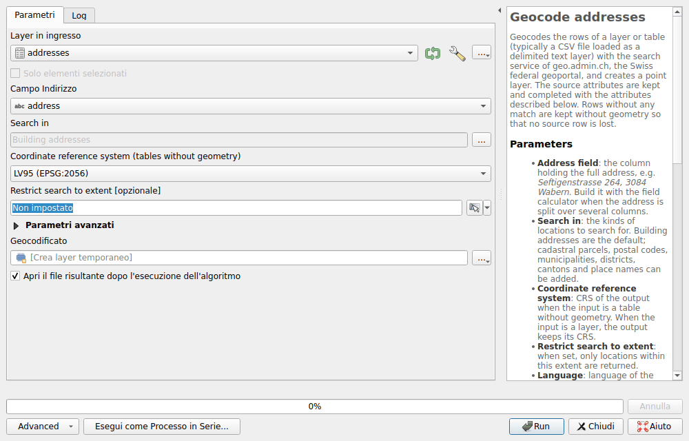
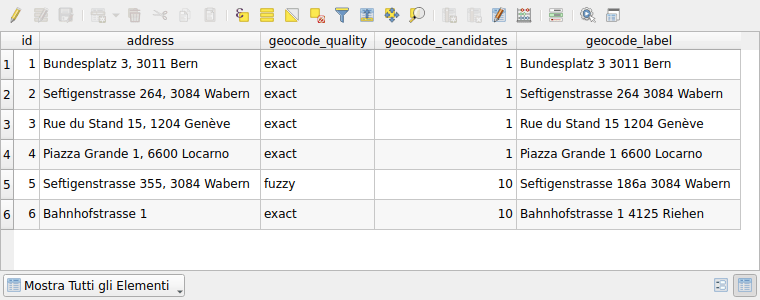

# Geocodifica

Trasformare una tabella di indirizzi, come un file CSV, in un layer di punti.
L'algoritmo di Processing **Geocode addresses** cerca ogni indirizzo con la
ricerca del geoportale, quella della [ricerca di località](search/locations.md),
e mantiene le colonne della tabella.

## Geocodificare una tabella

1. Caricare la tabella. Per un file CSV: **Layer ▸ Aggiungi Layer ▸ Aggiungi
   Layer Testo Delimitato...**, con **Nessuna geometria (solo tabella degli
   attributi)** come **Definizione della Geometria**.
2. Aprire **Processing ▸ Strumenti**, poi **Swiss Locator ▸ Geocoding ▸
   Geocode addresses**.
3. Scegliere la tabella come **Layer in ingresso**, e la colonna che contiene
   l'indirizzo completo come **Campo Indirizzo**, per esempio
   `Seftigenstrasse 264, 3084 Wabern`.
4. Cliccare su **Run**. I punti vengono aggiunti alla mappa come
   **Geocodificato**.



Quando l'indirizzo è suddiviso su più colonne, unirle prima con il
**Calcolatore di Campi**, per esempio
`concat("via", ' ', "numero", ', ', "nap", ' ', "localita")`.

Gli altri parametri:

- **Search in**: gli indirizzi degli edifici, per impostazione predefinita. Si
  possono aggiungere le particelle, i numeri postali d'avviamento, i comuni, i
  distretti, i cantoni e i nomi della carta nazionale.
- **Coordinate reference system (tables without geometry)**: MN95 o MN03. Un
  layer con una geometria mantiene la propria.
- **Restrict search to extent**: vengono trovate solo le località all'interno
  di questa estensione.
- Sotto **Parametri avanzati**, la lingua delle etichette, **Language**, e la
  pausa tra due richieste, **Pause between requests (milliseconds)**: vedere
  [l'uso corretto](#fair-use).

## Il risultato

Ogni riga dà un punto, con le colonne della tabella e questi attributi:

| Attributo | Contenuto |
|-----------|-----------|
| `geocode_quality` | `exact` quando ogni parola dell'indirizzo si trova nella località trovata, altrimenti `fuzzy` |
| `geocode_candidates` | Il numero di località trovate, fino a 10. Più di una significa che l'indirizzo è ambiguo: viene mantenuta la migliore. |
| `geocode_label` | La località trovata |
| `geocode_detail`, `geocode_origin`, `geocode_feature_id`, `geocode_rank`, `geocode_weight` | La località come restituita dal servizio. Per un indirizzo, l'identificativo contiene l'EGID e l'EDID del Registro federale degli edifici e delle abitazioni. |

Una riga senza località trovata, o la cui richiesta è fallita, viene mantenuta
senza geometria: nessuna riga va persa. Il log dell'algoritmo le elenca.



!!! warning
    La ricerca è approssimativa: trova quasi sempre una località, anche per un
    errore di battitura o un indirizzo che non esiste. Controllare
    `geocode_quality` prima di fidarsi di un punto. Qui sopra, non esiste una
    Seftigenstrasse 355 a Wabern: viene trovato il numero 186a, valutato
    `fuzzy`. `Bahnhofstrasse 1` è `exact`, ma ha 10 candidati: senza numero
    postale né località, potrebbe essere uno qualsiasi.

Per essere valutato `exact`, un numero dell'indirizzo, come il numero civico o
il numero postale d'avviamento, deve trovarsi in `geocode_label`. Una parola,
come il comune o il cantone, può trovarsi anche in `geocode_detail`.

Il servizio cerca al massimo dieci parole: di un indirizzo più lungo vengono
inviate solo le prime dieci parole.

## Uso corretto {#fair-use}

I servizi di geo.admin.ch sono gratuiti, nel rispetto di una
[politica di uso corretto](https://www.geo.admin.ch/it/condizioni-generali-di-utilizzo-ifdg)
di circa 20 richieste al minuto. L'algoritmo fa quindi una pausa di 3 secondi
tra due richieste: mille indirizzi richiedono circa 50 minuti. Gli indirizzi
identici vengono richiesti una sola volta.

Una richiesta che fallisce a causa della rete o di un servizio sovraccarico
viene ripetuta, fino a tre volte. Dopo cinque errori di questo tipo di
seguito, l'algoritmo si ferma: il servizio è molto probabilmente non
disponibile.

Per tabelle più grandi, scrivere prima a
[info@geo.admin.ch](mailto:info@geo.admin.ch), come chiedono le condizioni di
utilizzo, oppure usare l'elenco ufficiale degli indirizzi degli edifici di
swisstopo, un set di dati del [catalogo dei dati](downloads/index.md).

## Nei modelli e negli script

L'algoritmo funziona anche nella progettazione modello, nell'interfaccia di
elaborazione in serie e da Python:

```python
processing.run(
    "swiss_locator:geocodeaddresses",
    {"INPUT": layer, "FIELD": "address", "OUTPUT": "TEMPORARY_OUTPUT"},
)
```
