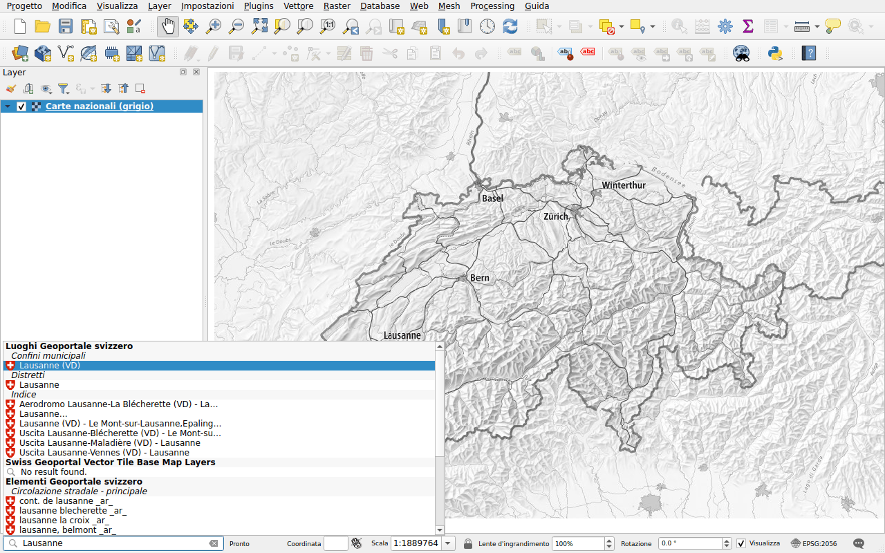
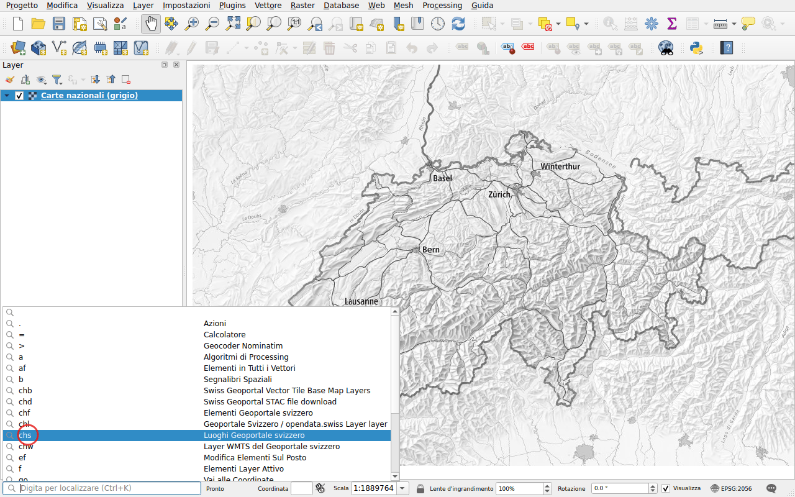

# Primi passi

## Installazione

In QGIS, aprire **Plugins ▸ Gestisci ed Installa Plugin...**, cercare
*Swiss Locator* e fare clic su **Installa Plugin**. Il plugin richiede QGIS 3.44
o successivo, QGIS 4 compreso.

## Ricerca

La barra di localizzazione si trova in basso a sinistra della finestra di QGIS.
Fare clic al suo interno, oppure premere ++ctrl+k++, e digitare almeno due
caratteri. I risultati arrivano man mano che i servizi rispondono, raggruppati
per tipo.

Fare doppio clic su un risultato, oppure selezionarlo con i tasti freccia e
premere ++enter++:

- un luogo o un oggetto: la mappa si sposta su di esso e lo evidenzia;
- un layer o una mappa di base: viene aggiunto alla mappa;
- un file: viene scaricato e aggiunto alla mappa.

## Restringere la ricerca con un prefisso

Senza prefisso vengono eseguite tutte le ricerche del plugin, oltre a quelle di
QGIS. Iniziare con un prefisso seguito da uno spazio per eseguirne una sola:

| Prefisso | Ricerca |
|----------|---------|
| `chs` | [Località](search/locations.md) |
| `chl` | [Layer](search/layers.md), del geoportale e di opendata.swiss |
| `chw` | [Layer WMTS](search/wmts.md) |
| `chb` | [Mappe di base](search/base-maps.md), in tile vettoriali |
| `chf` | [Oggetti](search/features.md) |
| `chd` | [Download di file](search/downloads.md) |

Ad esempio, `chs Lausanne` cerca solo i luoghi di nome Lausanne.

Non serve ricordarli: fare clic nella barra di localizzazione senza digitare
nulla, elenca tutte le ricerche con il loro prefisso. Fare doppio clic su una:
il suo prefisso viene digitato automaticamente.

I prefissi, e quali ricerche vengono eseguite senza prefisso, possono essere
modificati nelle [opzioni di QGIS](configuration.md#in-the-options-of-qgis).

## Lingua

I risultati arrivano nella lingua di QGIS se il geoportale è disponibile in
questa lingua: inglese, francese, tedesco, italiano o romancio. Altrimenti in
inglese. La lingua può essere impostata nella
[configurazione](configuration.md) del plugin.

## Sistema di riferimento delle coordinate

La mappa può usare qualsiasi sistema di riferimento delle coordinate. Il plugin
richiede i risultati in MN95 (EPSG:2056), o in MN03 (EPSG:21781) se il progetto
lo usa, e QGIS li trasforma.
