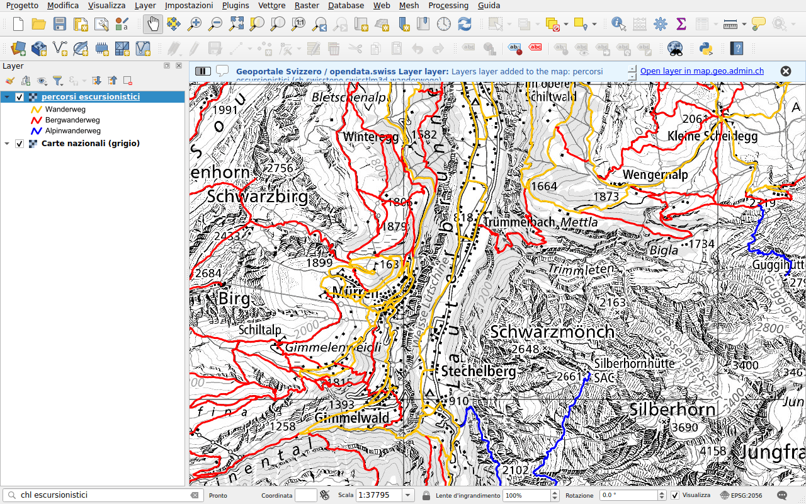

# Swiss Locator

Swiss Locator porta il geoportale federale in QGIS. Digitare nella barra di
localizzazione di QGIS, come su [map.geo.admin.ch](https://map.geo.admin.ch),
per trovare:

- **luoghi**: cantoni, comuni, distretti, numeri postali d'avviamento,
  indirizzi, particelle e i nomi della carta nazionale;
- **layer** del geoportale federale e dei servizi cantonali referenziati da
  [opendata.swiss](https://opendata.swiss), come WMS o WMTS;
- **mappe di base** di swisstopo, in tile vettoriali;
- **oggetti** dei layer del geoportale, come una fermata dei trasporti pubblici
  o una capanna alpina;
- **file da scaricare** dal catalogo dei dati del geoportale (STAC).

Il plugin disegna inoltre il terreno di swissALTI3D nei **profili altimetrici**
di QGIS.

## Per iniziare

1. In QGIS, aprire **Plugins ▸ Gestisci ed Installa Plugin...**, cercare
   *Swiss Locator* e installarlo. Richiede QGIS 3.44 o successivo.
2. Fare clic nella barra di localizzazione, in basso a sinistra della finestra,
   oppure premere ++ctrl+k++.
3. Digitare un luogo, ad esempio `Lausanne`, e fare doppio clic su un risultato.

[Primi passi](getting-started.md) spiega la barra di localizzazione. Poi è
possibile [cercare luoghi e oggetti](search/index.md),
[aggiungere layer](layers/index.md) o [scaricare dati](downloads.md).

## Informazioni

Il plugin è sviluppato da [OPENGIS.ch](https://opengis.ch) con il sostegno del
[gruppo svizzero degli utenti QGIS](https://qgis.ch). Il codice si trova su
[GitHub](https://github.com/opengisch/qgis-swiss-locator), dove è possibile
segnalare problemi.
