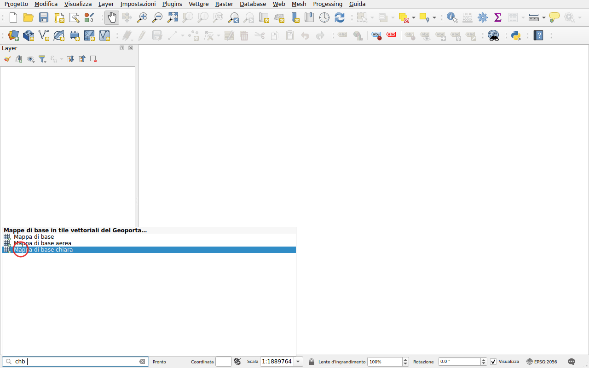
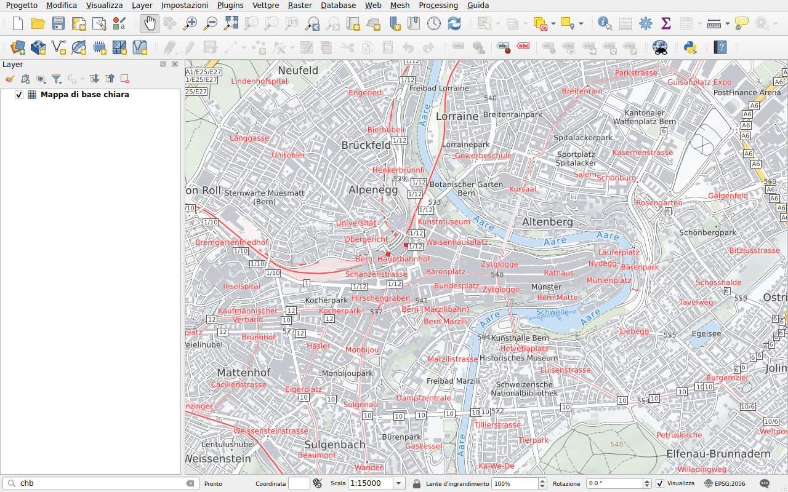

# Mappe di base

Prefisso: `chb`

Aggiungere una mappa di base di swisstopo, in tile vettoriali:

- **Mappa di base**, a colori;
- **Mappa di base chiara**, in grigio chiaro, per mettere in risalto i propri
  dati;
- **Mappa di base aerea**, immagini aeree con strade e nomi.

Le tile vettoriali restano nitide a qualsiasi scala.

Aggiunta a un progetto vuoto, una mappa di base imposta il progetto in MN95
(EPSG:2056), anziché in Web Mercator, il SR delle tile. Se **Usa un SR
predefinito** è scelto in **Impostazioni ▸ Opzioni ▸ SR e Trasformazioni ▸
Gestione del SR**, il progetto mantiene quel SR.

## Esempio

Digitare `chb` seguito da uno spazio: vengono elencate le tre mappe di base.

Fare doppio clic su **Mappa di base chiara**. La mappa viene aggiunta in fondo
ai layer, sotto i propri dati.

