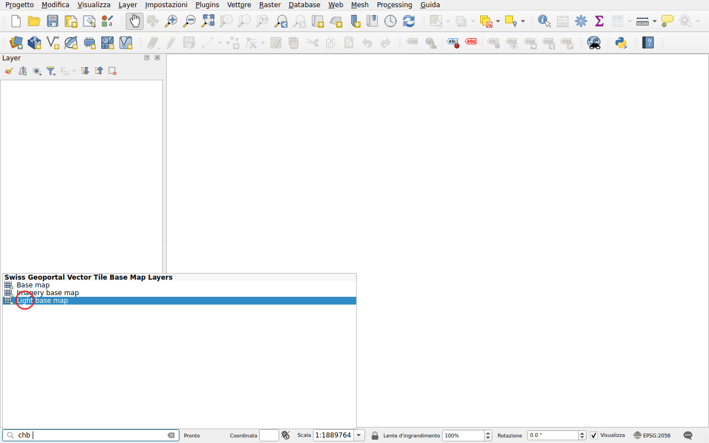
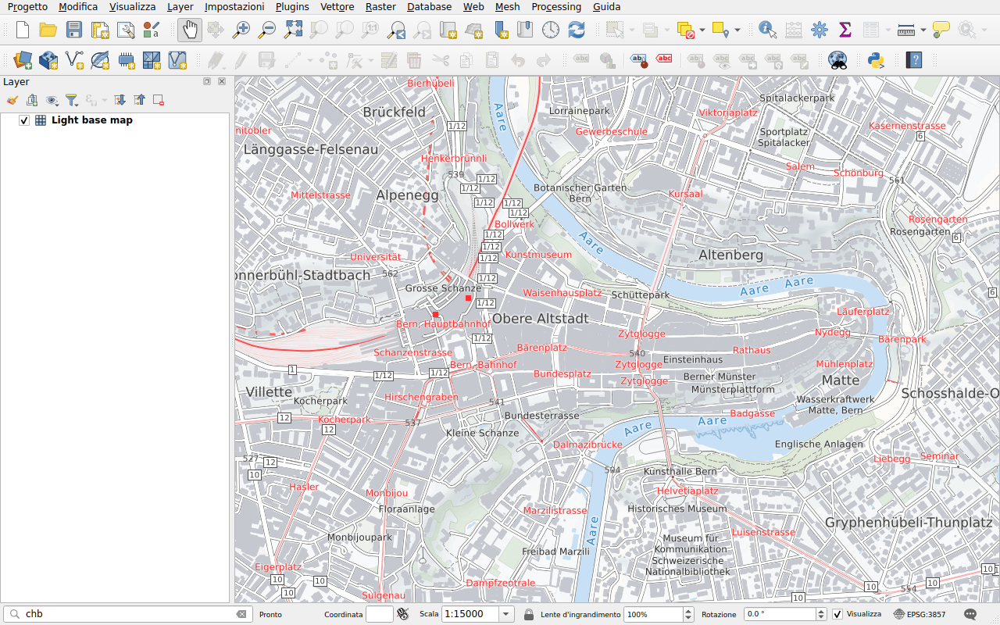

# Mappe di base

Prefisso: `chb`

Aggiungere una mappa di base di swisstopo, in tile vettoriali:

- **Base map**, a colori;
- **Light base map**, in grigio chiaro, per mettere in risalto i propri dati;
- **Imagery base map**, immagini aeree con strade e nomi.

Le tile vettoriali restano nitide a qualsiasi scala.

## Esempio

Digitare `chb` seguito da uno spazio: vengono elencate le tre mappe di base.

Fare doppio clic su **Light base map**. La mappa viene aggiunta in fondo ai
layer, sotto i propri dati.

