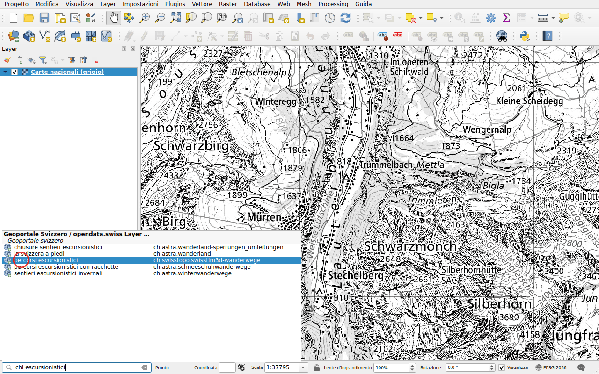
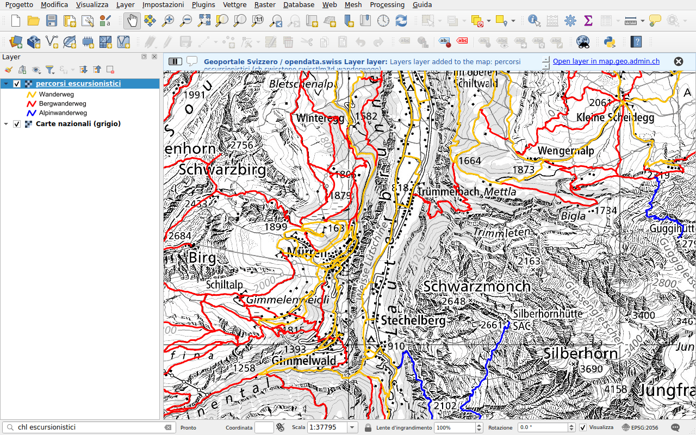
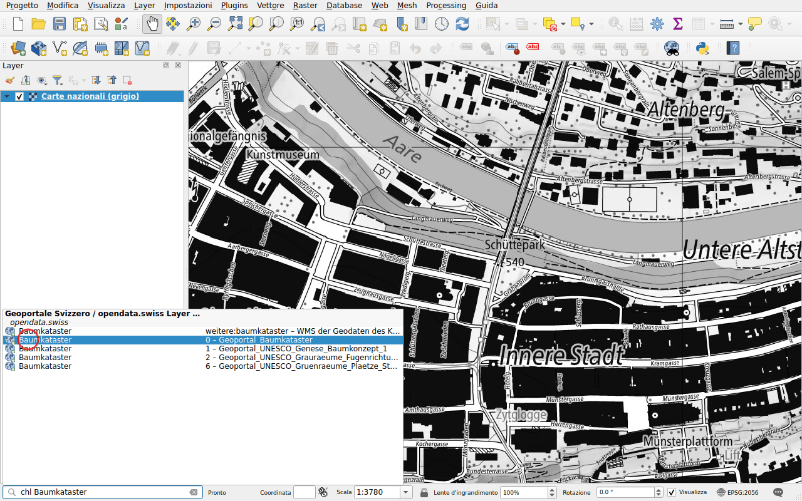
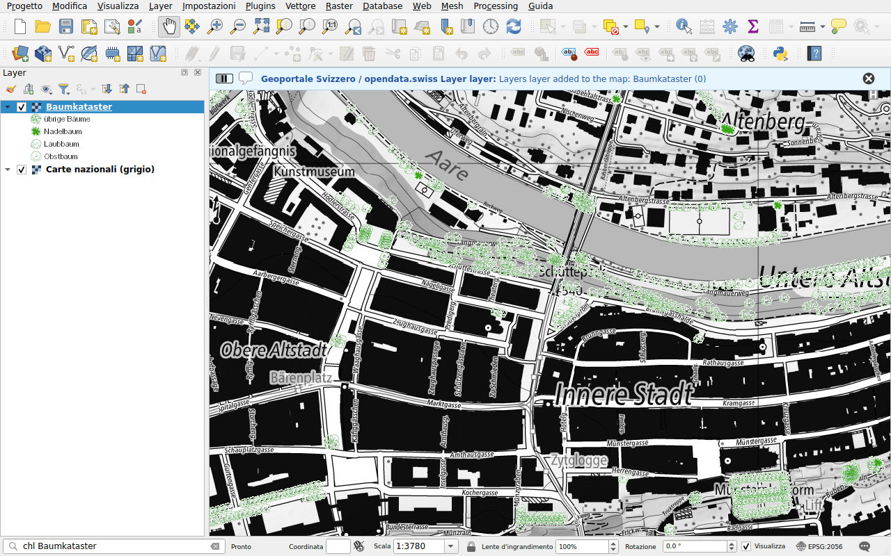

# Layer WMS

Prefisso: `chl`

Trovare un layer per nome o per titolo e aggiungerlo alla mappa come WMS. La
ricerca comprende:

- i layer del geoportale federale, map.geo.admin.ch;
- i layer dei servizi WMS di cantoni, città e altre organizzazioni
  referenziati da [opendata.swiss](https://opendata.swiss).

## Esempio: un layer del geoportale

Digitare `chl escursionistici`. I layer del geoportale sono elencati con il loro
identificatore.

Fare doppio clic su **percorsi escursionistici**. Il layer viene aggiunto alla
mappa, con la sua legenda. Un messaggio propone di aprire il layer su
map.geo.admin.ch.

## Esempio: un layer di un servizio cantonale

Cantoni e città pubblicano i propri servizi WMS, referenziati da opendata.swiss.
I loro layer si trovano per titolo, e anche per nome, come
`ch.gl.transportation.wanderwege`. I risultati compaiono sotto
**opendata.swiss**, con il nome del layer e il titolo del suo servizio. I titoli
sono nella lingua di chi pubblica il servizio, spesso in tedesco o in francese.

Digitare `chl Baumkataster`, il catasto degli alberi della città di Berna.

Fare doppio clic su un layer del servizio *Geoportal_Baumkataster*: gli alberi
di Berna compaiono sulla mappa.

!!! note
    I layer dei servizi referenziati da opendata.swiss sono elencati in un file
    pubblicato con questa documentazione, che QGIS scarica al massimo una volta
    al giorno, vedere [Fonti dei dati](../data-sources.md). Un layer aggiunto a
    un servizio appare dopo il prossimo aggiornamento dell'elenco.

La ricerca su opendata.swiss può essere disattivata nella
[configurazione](../configuration.md).
