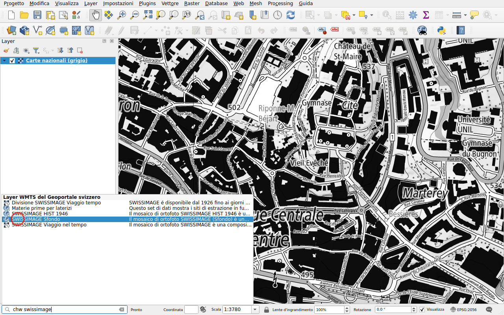
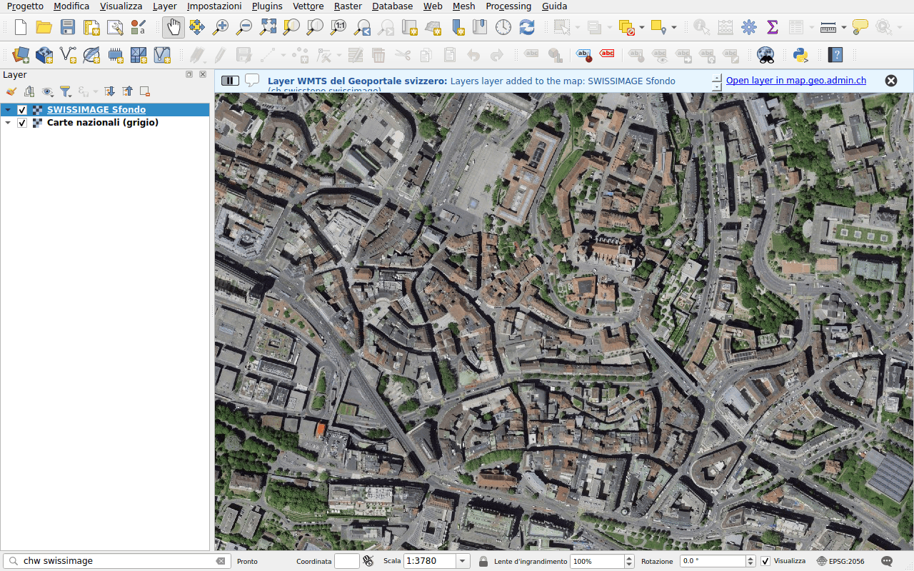

# Layer WMTS

Prefisso: `chw`

Trovare un layer del servizio WMTS del geoportale, wmts.geo.admin.ch, e
aggiungerlo alla mappa. Essendo suddivisi in tile, questi layer vengono
visualizzati più rapidamente dei layer WMS. La ricerca considera
l'identificatore, il titolo e la descrizione di ogni layer.

## Esempio: immagini aeree

Digitare `chw swissimage`.

Fare doppio clic su **SWISSIMAGE Sfondo**, le immagini aeree di swisstopo.

## Layer nel tempo

I layer con più date, come *Viaggio nel tempo*, hanno un'icona a forma di
orologio. QGIS li aggiunge come layer temporali: scegliere la data nel
pannello **Visualizza ▸ Pannelli ▸ Controllo Temporale**.

!!! note
    Alcuni layer del geoportale possono essere visualizzati solo su
    map.geo.admin.ch. Quando un layer non può essere aggiunto, un messaggio lo
    segnala.
