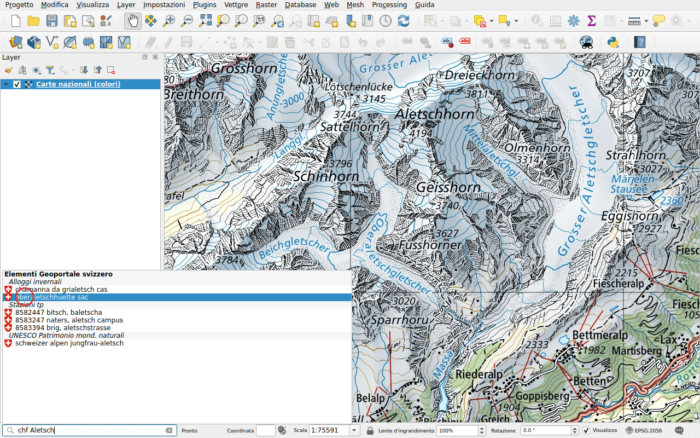
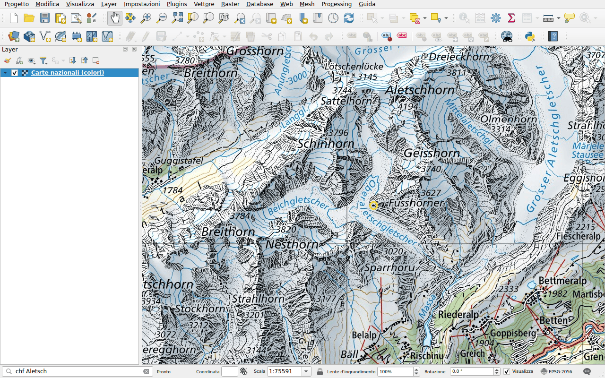

# Oggetti

Prefisso: `chf`

Trovare un oggetto nei layer del geoportale: una fermata dei trasporti
pubblici, una capanna alpina, un sito degli inventari federali, un punto fisso…
La ricerca richiede almeno quattro caratteri.

## Esempio

Digitare `chf Aletsch`. I risultati sono raggruppati per layer: una fermata dei
trasporti pubblici, il sito del patrimonio mondiale dell'UNESCO, capanne
alpine.

Fare doppio clic su **oberaletschhuette sac**. La mappa si centra sulla capanna
e la evidenzia con un cerchio.

## Scegliere i layer da cercare

I layer cercati sono quelli del geoportale con oggetti ricercabili, alcune
centinaia. Per cercarne solo alcuni, come le fermate dei trasporti pubblici,
selezionarli nella scheda **Ricerca di oggetti** della
[configurazione](../configuration.md#feature-search). L'esempio qui sopra
cerca in quattro layer: le fermate dei trasporti pubblici, i siti del
patrimonio mondiale dell'UNESCO, gli alloggi invernali e i geotopi.
