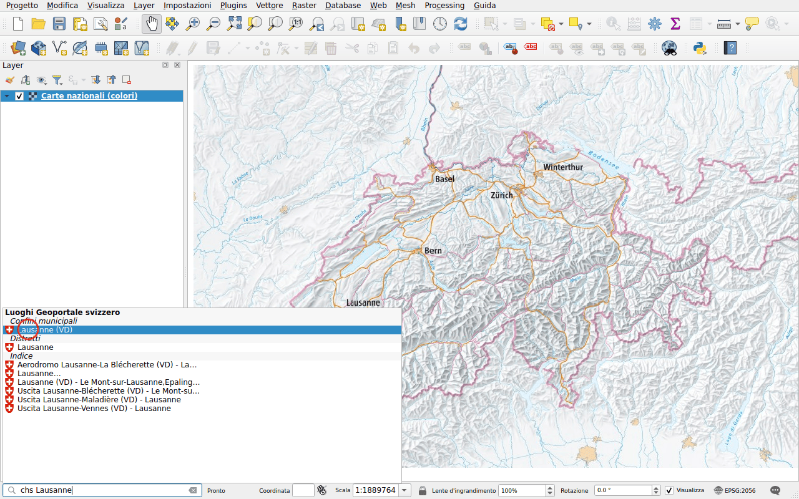
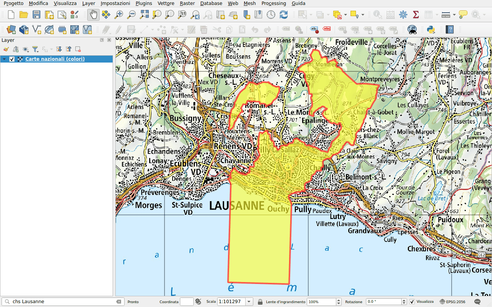
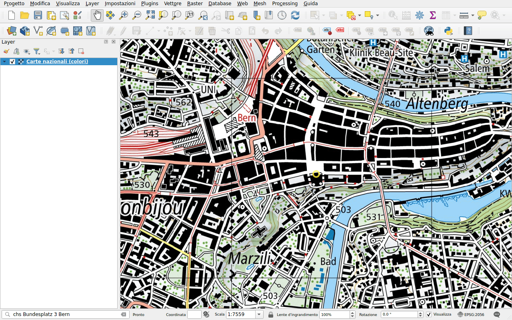

# Località

Prefisso: `chs`

Trovare un luogo come su map.geo.admin.ch:

- cantoni, distretti e comuni;
- numeri postali d'avviamento (NPA);
- indirizzi;
- particelle;
- i nomi della carta nazionale (swissNAMES3D), come una vetta, un lago o
  un'uscita autostradale.

## Esempio: un comune

Digitare `chs Lausanne`. I risultati sono raggruppati per tipo: il distretto, i
nomi della carta nazionale, il comune.

Fare doppio clic su **Lausanne (VD)** sotto **Confini municipali**. La mappa
esegue lo zoom sul comune e ne disegna il confine.

## Esempio: un indirizzo

Digitare `chs Bundesplatz 3 Bern` e scegliere l'indirizzo. La mappa si centra
sull'edificio e lo evidenzia con un cerchio.

!!! tip
    Per un punto, come un indirizzo, la mappa mantiene la scala attuale.
    Ingrandire prima, oppure usare in seguito gli strumenti di zoom.

L'evidenziazione di un luogo il cui confine non viene disegnato, come una
particella, scompare dopo alcuni secondi.
